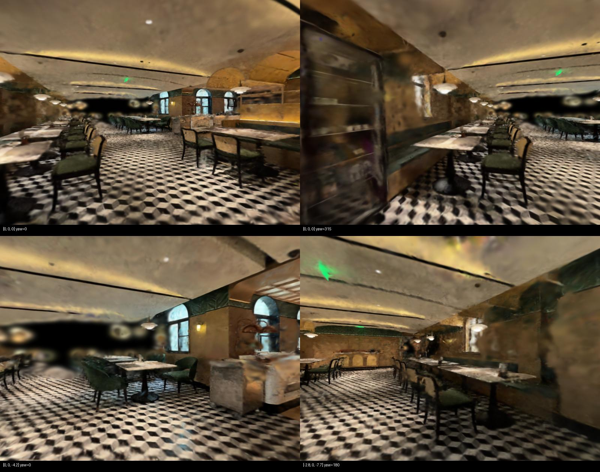

# GSAgent Eval

Standalone offline evaluation for GSAgent trajectories, with downloadable high-quality and degraded scenes.

独立评测器 **v0.1.2**，与 [原 gs-agent 项目](https://github.com/yankaiyang317-web/gs-agent) 配合使用。默认基准为 `jiudian_degraded_full_inputs_v1`、`guju_degraded_overlap_20261127`、`laojie_degraded_overlap_20261127`。A 衡量固定参考域的探索覆盖，B 衡量固定模型薄弱区域的视角价值；两项分开，不合成总分，也不跨场景比较原始分数。



## 下载并使用

```bash
git clone https://github.com/yankaiyang317-web/gs-agent-eval.git
cd gs-agent-eval
python scripts/download_benchmark.py
```

默认从[酒店 Release](https://github.com/yankaiyang317-web/gs-agent-eval/releases/tag/gs-agent-scenes-v2)和[故居、老街新版 Release](https://github.com/yankaiyang317-web/gs-agent-eval/releases/tag/gs-agent-scenes-v3)下载 **jiudian、guju、laojie 各自的高质量和退化版**，每对场景都包含 PLY、碰撞 GLB 和运行配置，同时下载对应固定评分状态。`--inputs` 可额外下载酒店已公开的 160 张合成 RGB 与辅助深度。故居 192 张、老街 256 张新版合成输入图暂留 machine25，未公开；选图、位姿和训练协议元数据随场景包公开。原始实拍照片和 COLMAP 不存在。下载后逐文件校验。

| 场景 | 用途 | 原 Agent 的配置入口 |
|---|---|---|
| 高质量酒店 `jiudian` | 原 Agent 默认探索的酒店，可直接运行测试 | `scenes/jiudian.json` |
| 低质量酒店 `jiudian_degraded` | 本仓库的低质量探索与离线评测基线 | `scenes/jiudian_degraded.json` |
| 高质量故居 `guju` | 原场景探索与参考 | `scenes/guju.json` |
| 退化故居 `guju_degraded_overlap` | 192 张重叠视角、15000 步重建，局部立面受控缺失 | `scenes/guju_degraded_overlap.json` |
| 高质量老街 `laojie` | 原场景探索与参考 | `scenes/laojie.json` |
| 退化老街 `laojie_degraded_overlap` | 256 张重叠视角、15000 步重建，桥亭仍薄弱 | `scenes/laojie_degraded_overlap.json` |

在原 Agent 的运行环境中选择对应 config 即可。每个场景的高质量目录为 `datasets/<scene>/reference/`，低质量目录为 `datasets/<scene>/navigation/`。故居和老街新版默认使用各自高质量场景的固定碰撞网格，另附从新版退化 PLY 生成的 splattransform 碰撞候选与独立配置。新版的训练、画面、碰撞和评分状态验收见[新版报告](docs/OVERLAP_BASELINES_20261127.md)。[旧版 81 帧试验](docs/NEW_SCENE_PILOT_20261125.md)仅适用于旧 PLY；不能作为新版成绩。另见[使用说明](docs/USAGE_WITH_AGENT.md)和[数据说明](datasets/DATA_CARD.md)。

```bash
# 在CUDA环境安装；测试过的版本见requirements-tested.txt。
pip install .
python -m gs_agent_eval verify --benchmark benchmarks/jiudian_degraded_full_inputs_v1.json
python -m gs_agent_eval score \
  --benchmark benchmarks/jiudian_degraded_full_inputs_v1.json \
  --run-dir /absolute/agent-run --out outputs/agent_v2/run_001 \
  --method-id agent_v2 --agent-version YOUR_AGENT_COMMIT
```

完整步骤见 [与原Agent配合使用](docs/USAGE_WITH_AGENT.md)。评分需要CUDA/PyTorch/gsplat；CPU测试不需要GPU。`Dockerfile.machine25`沿用已有测试运行时，公共`Dockerfile`提供可重建配方（该配方的全新镜像构建未在此版本验证）。

## 以后迭代Agent

修改Agent并记录commit/模型/提示词版本 → 相同场景、起点、相机和碰撞条件下生成轨迹 → 使用同一基准评分 → 每次输出到新目录。日常不必重新校准或补图训练。81帧包含视频记录的中间位姿和重复帧，连续三段不是三次独立实验。

```bash
python -m pytest -q
python -m gs_agent_eval compare --inputs outputs/a/summary.json outputs/b/summary.json --out outputs/comparison
```

原Agent独立维护；本包内部固定了PLY读取与坐标变换，不依赖Agent运行模块。大型数据/视频/模型均已Git忽略；冻结状态、原始场景SHA256和参数由profile绑定，数据变化会拒绝评分。

## 目录

- `gs_agent_eval/`, `gs_eval/`：独立CLI和评分核心。
- `benchmarks/`, `scenes/`, `datasets/*-downloads.json`：冻结协议、导航入口和数据下载清单。
- `templates/`, `tests/`, `fixtures/`：运行元数据、CPU测试和历史轨迹回归样本。
- `provenance/`, `research_snapshots/`：来源、历史实验报告和原场景专用研究脚本。
- `datasets/jiudian/`, `benchmark_data/`, `outputs/`：下载数据、冻结状态和新结果，均不进入Git。

本基准是可复现的单场景研究原型。B仍为实验性代理，不是实际修复量、概率或完整2D GauSS-MI复现；有帧间冗余和纯缺失区域盲点。法线由深度差分得到，参考域是部分域。GT补图已有小规模验证，生成视频增强尚未验证。详见 [冻结规则](docs/FROZEN_PROTOCOL.md)、[修改清单](docs/CHANGES.md)、[实验说明](docs/EXPERIMENTS.md)。
